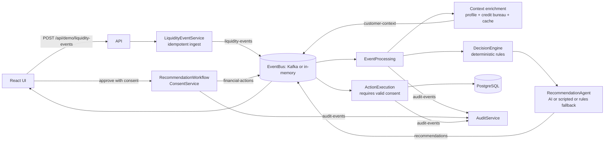

# Architecture

Modular monolith; each package could become a service (they communicate via the `EventBus` and repositories only).

Kafka topics: `liquidity-events`, `customer-context`, `recommendations`, `financial-actions`, `audit-events`.
Profiles: default (Postgres+Kafka), `demo` (H2+memory bus+scripted AI), `azure`/`gemini`/`openai`/`ollama` (LLM).