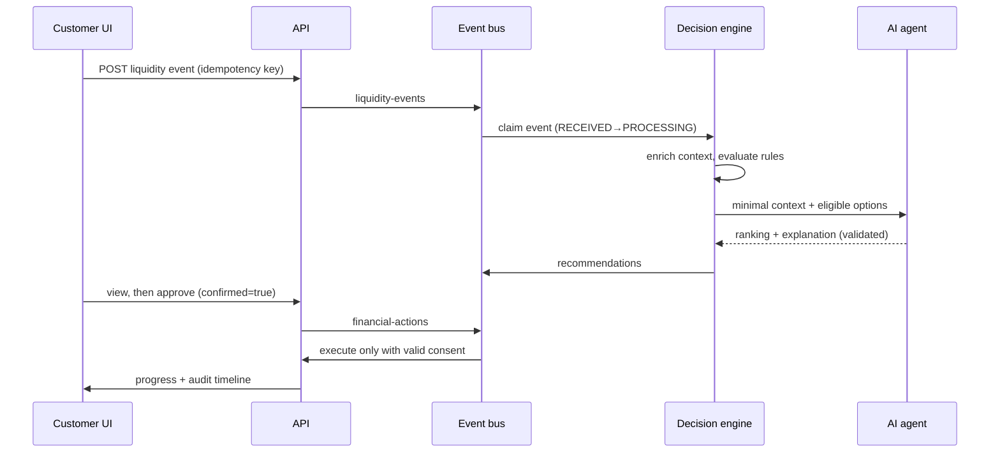

# Event flow

Correlation IDs (`COR-…`) and event IDs are in every log line and audit row.
Idempotency: unique idempotency key on ingest; consumers atomically claim the event; replays are audited as `DUPLICATE_EVENT_DETECTED`; approval and execution are guarded state transitions.